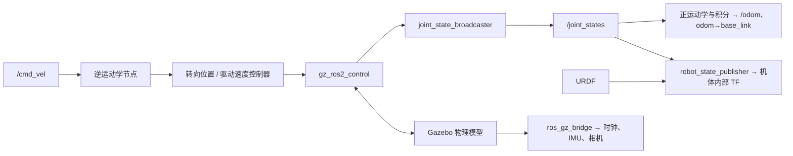

# 项目与参考架构

更新日期：2026-10-09。当前实现以提交 `200fc25` 为基准；原参考项目分析保留在后续独立章节，其基准见 [OVERVIEW.md](OVERVIEW.md)。

## 当前项目：模型显示

当前只有一个自有包 `swerve_nav`，包名不等于节点名。包内尚无自有 C++ 节点、world、控制器 YAML 或 Gazebo 启动文件。

| 当前文件 | 已实施职责 |
| --- | --- |
| [CMakeLists.txt](../src/swerve_nav/CMakeLists.txt)、[package.xml](../src/swerve_nav/package.xml) | `ament_cmake` 资源包；安装 urdf、launch，声明模型显示及 Gazebo 集成依赖；预设 C++20 |
| [robot.urdf.xacro](../src/swerve_nav/urdf/robot.urdf.xacro) | 集中主要物理参数，组合车体、轮组和传感器，保留 ros2_control/Gazebo 插件声明 |
| [wheel.urdf.xacro](../src/swerve_nav/urdf/wheel.urdf.xacro) | 固定支撑、转向叉、滚动轮及各自惯量；8 个运动关节及控制接口声明 |
| [camera.urdf.xacro](../src/swerve_nav/urdf/camera.urdf.xacro)、[laser.urdf.xacro](../src/swerve_nav/urdf/laser.urdf.xacro) | 相机外壳与光学帧、雷达外壳与支架，以及传感器定义 |
| [display.launch.py](../src/swerve_nav/launch/display.launch.py) | 展开 Xacro，启动 robot_state_publisher、joint_state_publisher_gui、rviz2 三个现成节点 |

显示入口的数据关系为：Xacro → `robot_description` → robot_state_publisher；joint_state_publisher_gui 接收描述并发布手动关节状态；robot_state_publisher 发布机器人内部 TF，RViz 用于显示。滑块产生的姿态不是物理仿真或编码器反馈。

当前 display launch 不加载控制器 YAML 或专用 `.rviz` 配置，不启动 Gazebo、控制管理器或 ROS/Gazebo 桥接，也未设置 `use_sim_time=true`。传感器和控制插件写入 URDF 不等于相应系统已经运行；`controllers_config` 参数默认仍为空。声明依赖也不代表依赖已全部安装或兼容性已验证。

## 参考项目模块与源码入口

| 参考文件 | 职责 |
| --- | --- |
| [robot.urdf.xacro](../REF/omnidirectional_four_wheeled_robot/urdf/robot.urdf.xacro) | 组合机体、四轮、传感器和 ros2_control 配置 |
| [wheel.urdf.xacro](../REF/omnidirectional_four_wheeled_robot/urdf/wheel.urdf.xacro) | 每个轮组的转向/驱动关节、几何、惯量和控制接口 |
| [empty.sdf](../REF/omnidirectional_four_wheeled_robot/worlds/empty.sdf) | 地面、光照、物理、场景、传感器与 IMU 系统 |
| [gazebo.launch.py](../REF/omnidirectional_four_wheeled_robot/launch/gazebo.launch.py) | 展开 Xacro，启动 Gazebo、状态发布器、桥接、控制器、运动学和里程计；可选 GUI/RViz |
| [display.launch.py](../REF/omnidirectional_four_wheeled_robot/launch/display.launch.py) | 独立模型显示入口，与物理仿真入口分开 |
| [controller_kinematics.cpp](../REF/omnidirectional_four_wheeled_robot/src/controller_kinematics.cpp) | 机体速度到四轮转角/轮速的逆运动学节点 |
| [odometry_publisher.cpp](../REF/omnidirectional_four_wheeled_robot/src/odometry_publisher.cpp) | 实测关节状态到平面速度、位姿积分、里程计及 TF |
| [robot_geometry.hpp](../REF/omnidirectional_four_wheeled_robot/include/omnidirectional_four_wheeled_robot/robot_geometry.hpp) | C++ 正逆运动学共用的轮位、半径、顺序常量 |

## 参考数据流

参考 launch 由 `gz_ros2_control` 在 Gazebo 中创建控制管理器，模型生成进程退出后调起 joint_state_broadcaster，再调起位置和速度控制器。事件触发并不等于所有前置条件已验证成功。机器人和示例球体均由 `ros_gz_sim/create` 生成。

另有 [spawner_sphere.cpp](../REF/omnidirectional_four_wheeled_robot/src/spawner_sphere.cpp) 可执行程序，使用 ROS SpawnEntity 服务；主 Gazebo launch 并未启动这个自定义程序，不应混淆两条生成路径。

## 运动学阅读要点

- 逆解对第 i 轮计算 `vxi = vx - yi * wz`、`vyi = vy + xi * wz`，由 atan2 得到转向目标，再通过翻转角度与轮速缩短转向变化。参考节点按 10 Hz 墙上时间定时发布，控制管理器配置为 100 Hz。
- 上一转角保存在逆解节点中，是上次目标，不是关节反馈。低速度分支保留角度；命令超时、限速和实际转向过程需要另行验证。
- 正解使用反馈转角与轮速，根据四轮对称布局求平面速度，再按 JointState 时间戳进行中点积分；缺少所需关节或时间增量异常时跳过更新。
- 正逆解共享 C++ 几何常量，但 URDF 仍单独写有对应参数。两处一致性需要维护，不能视为已经实现单一参数源。

## 尚未包含的能力

当前参考树未提供本项目所需的完整 SLAM、已知地图定位、Nav2 规划/跟踪与自主导航配置。它提供模型、底盘控制和里程计参考；最终系统如何组合成熟组件与自研算法，待用户逐步确定。
