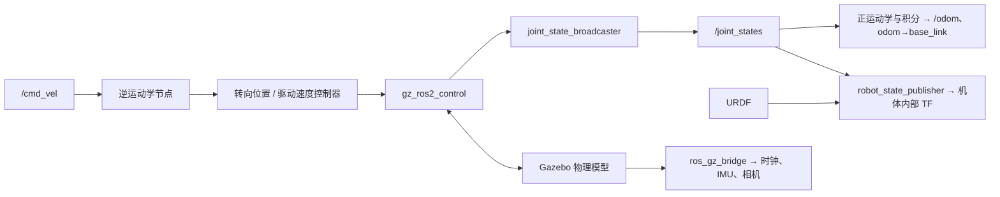

# 项目与参考架构

更新日期：2026-11-09。当前实现以 `fc446df` 加工作区修改为准；参考版本见 [OVERVIEW.md](OVERVIEW.md)。2026-10-09 的 `200fc25` 快照只有模型显示，没有 Gazebo 入口和控制器 YAML，属于历史基线。

## 当前项目：模型显示

当前只有一个自有包 `swerve_nav`，包名不等于节点名。显示与仿真入口均在此包内；C++ 节点文件仍为空，尚无可执行节点目标。

| 当前文件 | 已实施职责 |
| --- | --- |
| [CMakeLists.txt](../src/swerve_nav/CMakeLists.txt)、[package.xml](../src/swerve_nav/package.xml) | 安装 urdf、launch、config 和 LICENSE；声明仿真依赖，构建包内 C++20 静态库 |
| [robot.urdf.xacro](../src/swerve_nav/urdf/robot.urdf.xacro) | 集中主要物理参数，组合车体、轮组和传感器，保留 ros2_control/Gazebo 插件声明 |
| [wheel.urdf.xacro](../src/swerve_nav/urdf/wheel.urdf.xacro) | 固定支撑、转向叉、滚动轮及各自惯量；8 个运动关节及控制接口声明 |
| [camera.urdf.xacro](../src/swerve_nav/urdf/camera.urdf.xacro)、[laser.urdf.xacro](../src/swerve_nav/urdf/laser.urdf.xacro) | 相机外壳与光学帧、雷达外壳与支架，以及传感器定义 |
| [display.launch.py](../src/swerve_nav/launch/display.launch.py) | 展开 Xacro，启动 robot_state_publisher、joint_state_publisher_gui、rviz2 三个现成节点 |

显示入口的数据关系为：Xacro → `robot_description` → robot_state_publisher；joint_state_publisher_gui 接收描述并发布手动关节状态；robot_state_publisher 发布机器人内部 TF，RViz 用于显示。滑块产生的姿态不是物理仿真或编码器反馈。

当前 display launch 不加载控制器 YAML 或专用 `.rviz` 配置，不启动 Gazebo、控制管理器或 ROS/Gazebo 桥接，也未设置 `use_sim_time=true`。传感器和控制插件写入 URDF 不等于相应系统已经运行；`controllers_config` 参数默认仍为空。声明依赖也不代表依赖已全部安装或兼容性已验证。

## 当前项目：Gazebo 与关节控制

- [gazebo.launch.py](../src/swerve_nav/launch/gazebo.launch.py) 使用 Gazebo 自带 `empty.sdf`，展开模型时传入 [controllers.yaml](../src/swerve_nav/config/controllers.yaml) 的安装路径，启动 robot_state_publisher 并生成机器人。`gui:=false` 可只启动仿真服务端。
- URDF 中的 `gz_ros2_control` 插件在 Gazebo 内创建 controller_manager；模型成功生成后，spawner 激活关节状态广播器及转向、驱动控制器。生成或控制器激活失败会触发 launch 关闭。
- 关节命令经 ROS 控制器和 `gz_ros2_control` 作用于仿真模型；反馈由 joint_state_broadcaster 发布为 `/joint_states`，供 robot_state_publisher 更新内部 TF。此链路不通过 `ros_gz_bridge` 转发关节命令。
- launch 已通过参数直接配置单向 `/clock` 桥接，ROS 仿真时间供状态发布器和控制管理器使用。目前没有自有 `gz_bridge.yaml`；IMU、相机、雷达数据尚未接入 ROS。增加 YAML 本身不会启动 Gazebo 传感器系统。
- 此入口没有 RViz、joint_state_publisher_gui、逆解、里程计或 Nav2 节点。Gazebo 运行时不应另外启动 display launch 的手动关节状态发布器，与实际反馈争用 `/joint_states`。

话题、数组顺序和限位见 [INTERFACES.md](INTERFACES.md)，实际验证范围见 [PROGRESS.md](PROGRESS.md)。launch 的参考文件、基准提交及完整许可保留在包内 [LICENSE](../src/swerve_nav/LICENSE)。

## 当前项目：运动学构建与待实现边界

已建立 `swerve_kinematics` 静态库目标，源文件为 [src/swerve_kinematics.cpp](../src/swerve_nav/src/swerve_kinematics.cpp)，PUBLIC 头文件搜索路径为包内 `include/`；使用扁平头文件路径 [include/swerve_kinematics.hpp](../src/swerve_nav/include/swerve_kinematics.hpp)。当前仅供包内构建，没有库/头文件安装和对外导出，也没有新增算法依赖。

头文件当前已定义 `swerve_nav::WheelConfig`，保存一个单滚动轮转向模块的几何和运动约束，具体字段见 [轮组配置](INTERFACES.md#当前轮组配置类型)。算法 `.cpp` 和 [节点 .cpp](../src/swerve_nav/src/swerve_kinematics_node.cpp) 仍为空；当前没有解算函数、参数校验、加减速目标生成或节点可执行目标。

讨论中的分工是：纯 C++ 算法通过参数接收布局、整车目标速度和轮组反馈；节点负责模型与配置解析、ROS 通信及周期调用。机械参数从同一份展开后的 `robot_description` 提取，关节配对、轮序与控制参数单独配置，是已讨论但尚未实现的方案；URDF 解析方式、类型接口及 `/cmd_vel` 消息类型尚未定案。算法和节点的推进方式见 [DECISIONS.md](DECISIONS.md)。

## 用户运控库的参考范围

以下源自 `VehicleMotionControl` 的静态阅读，基准及未提交修改边界见 [OVERVIEW.md](OVERVIEW.md)：

| 参考入口 | 可参考职责 |
| --- | --- |
| [MultiSteerKinematics.cs](../参考项目/VehicleMotionControl/Chassis/MultiSteer/MultiSteerKinematics.cs) | 车体速度到各转向轴处速度向量 |
| [MultiSteerSetpointGenerator.cs](../参考项目/VehicleMotionControl/Chassis/MultiSteer/MultiSteerSetpointGenerator.cs) | 限位内正反轮向选解、分支滞回、整组限速、减速与转向到位流程 |
| [MultiSteerForwardKinematics.cs](../参考项目/VehicleMotionControl/Chassis/MultiSteer/MultiSteerForwardKinematics.cs) | 轮组反馈到车体速度估计，供后续里程计阶段参考 |
| [PoseTrackingController.cs](../参考项目/VehicleMotionControl/Control/Omnidirectional/PoseTrackingController.cs) | 轨迹与位姿反馈到整车速度，供后续轨迹跟踪阶段参考 |

当前仿真轮组为单转向关节加单滚动轮，对应旧库的 `SteerWheel`；`DiffSteerWheelAllocator` 针对一个模块内的左右双驱动轮，不适用于当前模型。旧库模块滚动速度单位为 m/s，当前驱动关节命令为 rad/s，接入时需按轮半径转换。旧库已有验证记录不能替代本项目 C++ 移植及 Gazebo 验证。

## 参考项目模块与源码入口

| 参考文件 | 职责 |
| --- | --- |
| [robot.urdf.xacro](../参考项目/omnidirectional_four_wheeled_robot/urdf/robot.urdf.xacro) | 组合机体、四轮、传感器和 ros2_control 配置 |
| [wheel.urdf.xacro](../参考项目/omnidirectional_four_wheeled_robot/urdf/wheel.urdf.xacro) | 每个轮组的转向/驱动关节、几何、惯量和控制接口 |
| [empty.sdf](../参考项目/omnidirectional_four_wheeled_robot/worlds/empty.sdf) | 地面、光照、物理、场景、传感器与 IMU 系统 |
| [gazebo.launch.py](../参考项目/omnidirectional_four_wheeled_robot/launch/gazebo.launch.py) | 展开 Xacro，启动 Gazebo、状态发布器、桥接、控制器、运动学和里程计；可选 GUI/RViz |
| [display.launch.py](../参考项目/omnidirectional_four_wheeled_robot/launch/display.launch.py) | 独立模型显示入口，与物理仿真入口分开 |
| [controller_kinematics.cpp](../参考项目/omnidirectional_four_wheeled_robot/src/controller_kinematics.cpp) | 机体速度到四轮转角/轮速的逆运动学节点 |
| [odometry_publisher.cpp](../参考项目/omnidirectional_four_wheeled_robot/src/odometry_publisher.cpp) | 实测关节状态到平面速度、位姿积分、里程计及 TF |
| [robot_geometry.hpp](../参考项目/omnidirectional_four_wheeled_robot/include/omnidirectional_four_wheeled_robot/robot_geometry.hpp) | C++ 正逆运动学共用的轮位、半径、顺序常量 |

## 参考数据流

参考 launch 由 `gz_ros2_control` 在 Gazebo 中创建控制管理器，模型生成进程退出后调起 joint_state_broadcaster，再调起位置和速度控制器。事件触发并不等于所有前置条件已验证成功。机器人和示例球体均由 `ros_gz_sim/create` 生成。

另有 [spawner_sphere.cpp](../参考项目/omnidirectional_four_wheeled_robot/src/spawner_sphere.cpp) 可执行程序，使用 ROS SpawnEntity 服务；主 Gazebo launch 并未启动这个自定义程序，不应混淆两条生成路径。

## 运动学阅读要点

- 逆解对第 i 轮计算 `vxi = vx - yi * wz`、`vyi = vy + xi * wz`，由 atan2 得到转向目标，再通过翻转角度与轮速缩短转向变化。参考节点按 10 Hz 墙上时间定时发布，控制管理器配置为 100 Hz。
- 上一转角保存在逆解节点中，是上次目标，不是关节反馈。低速度分支保留角度；命令超时、限速和实际转向过程需要另行验证。
- 正解使用反馈转角与轮速，根据四轮对称布局求平面速度，再按 JointState 时间戳进行中点积分；缺少所需关节或时间增量异常时跳过更新。
- 正逆解共享 C++ 几何常量，但 URDF 仍单独写有对应参数。两处一致性需要维护，不能视为已经实现单一参数源。

## 原始参考项目尚未包含的能力

`omnidirectional_four_wheeled_robot` 未提供本项目所需的完整 SLAM、已知地图定位、Nav2 规划/跟踪与自主导航配置。它提供模型、底盘控制和里程计参考。

新增导航、控制和规划参考的用途及本地版本统一见 [参考资料基准](OVERVIEW.md#参考资料基准)。linorobot2 用于阅读完整机器人集成方式，navigation2 用于阅读导航组件实现，两者职责不同。参考目录中的功能不是本项目成果；采用哪个组件、如何连接自研算法，仍按用户后续指令逐步确定。
